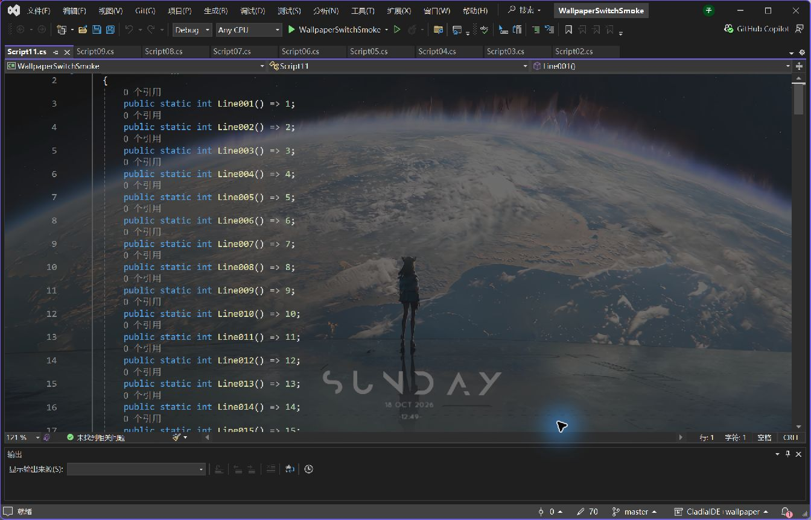

# ClaudiaIDE-WallpaperEngine

让 Visual Studio 2022 的编辑器背景跟随 Wallpaper Engine 当前壁纸，支持视频和部分动态场景。

**[⬇ 下载稳定版 3.1.52.13（VSIX，双击安装）](https://github.com/oldnoob666/ClaudiaIDE-WallpaperEngine/releases/download/v3.1.52.13/ClaudiaIDE-WallpaperEngine-3.1.52.13.vsix)** · [最新正式版](https://github.com/oldnoob666/ClaudiaIDE-WallpaperEngine/releases/latest) · [安装与常见问题](docs/quick-start.md) · [反馈问题](https://github.com/oldnoob666/ClaudiaIDE-WallpaperEngine/issues)

**[测试版 3.1.52.14 Preview 1：工具窗口背景透明](https://github.com/oldnoob666/ClaudiaIDE-WallpaperEngine/releases/tag/v3.1.52.14-preview.1)**（Pre-release）。适合希望试用新功能的用户；日常使用可继续选择上方稳定版。测试源码位于 `codex/tool-window-transparency` 分支，稳定版源码保留在 `main`。

面向 **Windows x64 / Visual Studio 2022**，不是 VS Code 插件。需要本机已安装 Wallpaper Engine 和 [WebView2 Runtime](https://developer.microsoft.com/microsoft-edge/webview2/#download-section)。普通用户不需要下载源码、安装 Node.js 或编译项目。



## 三步开始

1. **下载并安装**：下载上方 `.vsix` 安装包，关闭 Visual Studio 后双击安装，再重新打开 VS。已经安装原版 ClaudiaIDE 时，先阅读[原版替换说明](docs/quick-start.md#已经安装了原版-claudiaide)。
2. **应用桌面壁纸**：在 Wallpaper Engine 中应用一张视频或场景壁纸，并打开一个代码文件。
3. **检测并启用**：点击 **扩展 → ClaudiaIDE → 启用 Wallpaper Engine 动态背景…**。窗口自动检测目录、显示器和 WebView2，确认要跟随的显示器后点击 **启用当前壁纸**，关闭窗口即可查看。

`Ctrl+Shift+Alt+C` 可显示/隐藏背景。透明度在“扩展 → ClaudiaIDE → 打开设置”的浅色/深色主题中调整。遇到无画面时，重新打开启用窗口查看诊断，或查阅[常见问题](docs/quick-start.md#常见问题)。

这是基于 [buchizo/ClaudiaIDE](https://github.com/buchizo/ClaudiaIDE) Release3.1.52 的**非官方衍生版**，由 [oldnoob666](https://github.com/oldnoob666) 维护。原始背景功能来自 ClaudiaIDE；本仓库增加 Wallpaper Engine 联动、动态播放、滚动固定和左侧行号/断点栏覆盖。与 ClaudiaIDE 原作者、Wallpaper Engine 官方没有隶属关系。

## 功能

- 跟随指定显示器的 Wallpaper Engine 当前选择；切换壁纸后通常数秒内更新。
- 视频静音循环播放，动态场景通过 WebWallGL 渲染。
- 背景覆盖代码区及左侧行号、断点栏；上下、左右滚动代码时背景保持原位。
- 支持透明度、浅色/深色主题设置和 `Ctrl+Shift+Alt+C` 显示/隐藏。
- 3.1.52.14 新增可选的「工具窗口背景透明」：Wallpaper Engine 模式下，主窗口停靠区共用一张动态壁纸，输出、解决方案资源管理器等工具窗口透出背景；默认关闭，关闭后恢复原有外观。
- 保留 ClaudiaIDE 原有图片和幻灯片模式；新建受支持的文本编辑视图也会显示背景。
- 默认只为可见的编辑区加载壁纸；隐藏标签、最小化 VS、隐藏背景或关闭视图时释放对应播放器，切回后自动重建。开启工具窗口透明后，主窗口停靠区共用一个播放器。
- 加载期间保留编辑器主题底色；首帧就绪后按设置的透明度显示背景，避免初始化白底闪现。

## 安装与兼容

- 使用 [GitHub Releases](https://github.com/oldnoob666/ClaudiaIDE-WallpaperEngine/releases/latest) 中的 `.vsix`，不是自动生成的 `Source code.zip`。安装、更新、卸载和恢复原版见[完整教程](docs/quick-start.md)。
- 本版沿用 ClaudiaIDE 扩展标识，按原版的替换版使用，不要同时启用两版。安装器拒绝替换时，先在 VS 扩展管理器卸载原版，再安装本版。
- 当前验证范围为 Windows x64 / VS 2022；仓库保留的 VS 2019 工程及 Windows ARM64 不在本次验证范围。
- Wallpaper Engine 未运行时使用其配置文件最后保存的选择。各编辑区独立播放，播放进度不与桌面逐帧同步。
- 下载入口固定指向本视频推广稳定版；后续试验功能会标记为预发布。更新前可先查看 Release 说明。

## 从源码构建

安装 Visual Studio 2022 的“Visual Studio 扩展开发”工作负载及 .NET Framework 4.7.2 targeting pack。测试工程另需 .NET 9 SDK。在 **Developer PowerShell for VS 2022** 中进入源码根目录：

```powershell
MSBuild.exe ClaudiaIDE\ClaudiaIDE.csproj /restore /p:Configuration=Release /v:minimal /nologo
dotnet run --project tests\WallpaperEngine.Tests
```

安装包位于 `ClaudiaIDE\bin\Release\net472\ClaudiaIDE.vsix`。构建会还原 NuGet 依赖；播放器和查询工具随包分发，运行时不需要 Node.js、npm 或 CDN。

## 已知限制

- WebWallGL 是第三方场景渲染器，并非所有工坊场景、脚本或交互效果都兼容；不执行应用类壁纸。
- 默认每个可见编辑视图有自己的播放器；开启工具窗口透明后，主窗口共用一个播放器。独立浮动编辑器及多个 VS 进程仍会增加内存和 GPU 占用；同一进程共享浏览器环境和缓存，释放播放器后进程内存也不会归零。
- 隐藏后重新打开需要重建播放器，播放进度不保留。首次启动仍需初始化 WebView2 和读取素材，复杂场景可能需要数秒；详见 [资源生命周期与加载说明](docs/runtime-lifecycle.md)。
- 默认动态背景覆盖受支持的文本编辑器窗格。3.1.52.14 可在当前浅色/深色主题设置中开启「工具窗口背景透明」扩展到主窗口停靠区域；独立浮动工具窗口、原生 HWND/第三方自绘窗口不保证透明，文字、选中高亮、输入控件与命令栏保留原有样式。
- 日志位于 `%LOCALAPPDATA%\ClaudiaIDE\WallpaperEngine.log`，WebView2 数据位于 `%LOCALAPPDATA%\ClaudiaIDE\WebView2`。

详细使用和排查见 [联动说明](docs/wallpaper-engine.md)，实现参考见 [参考项目拆解](docs/参考项目拆解.md)。`WORK-LOG.md` 和设计文档保留开发过程中的历史验证记录，文中“本机”结果不代表所有环境都已验证。

## 来源与许可证

- **ClaudiaIDE**：原作者 [buchizo](https://github.com/buchizo)，基线提交 `23d555d0a817c3deee34961bff18412c9e26b5b0`。保留原提交历史、署名和 [Ms-PL 许可证](LICENSE)，原始说明见 [README.upstream.md](README.upstream.md)。本仓库对 ClaudiaIDE 的新增和修改代码同样按 Ms-PL 分发。
- **WebWallGL 3.0.0**：由 [oneincase/webwallgl](https://github.com/oneincase/webwallgl) 提供场景渲染，按 [MIT 许可证](Shared/WallpaperEngine/Player/WebWallGL-LICENSE.txt) 分发。
- **设计参考**：[elysia395/dsh-wallpaper-engine](https://github.com/elysia395/dsh-wallpaper-engine)，参考提交 `01fbb8b8e66fd7e405e9c878d18dbd456187f111`，用于理解壁纸素材读取及浏览器播放方式。

其他 NuGet 依赖遵循各自许可证。仓库不包含 Wallpaper Engine 程序或用户的工坊壁纸素材；这些素材的权利归各自作者。上游图片、图标及原有声明随源代码保留，软件许可证不授予商标权。GitHub 的 Sponsor 链接沿用上游配置，支持的是原作者 buchizo。

