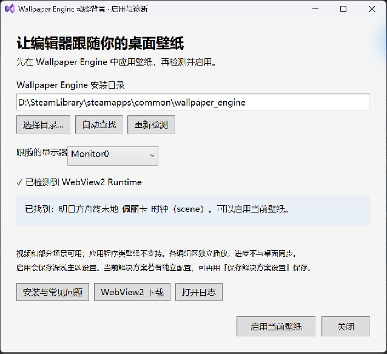

# 安装、启用与常见问题

适用于 ClaudiaIDE Wallpaper Engine 非官方联动版 **3.1.52.13**，当前验证范围是 Windows x64 和 Visual Studio 2022。

## 下载安装

1. 打开[稳定版下载页面](https://github.com/oldnoob666/ClaudiaIDE-WallpaperEngine/releases/tag/v3.1.52.13)，在 Assets 中下载 `ClaudiaIDE-WallpaperEngine-3.1.52.13.vsix`。`Source code` 是开发源码，普通用户不用下载。
2. 关闭所有 Visual Studio 窗口，双击 `.vsix`，选择自己的 VS 2022 并按安装器提示完成安装。
3. 重新启动 VS，打开任意受支持的代码/文本文件。扩展位于“扩展 → ClaudiaIDE”。安装包已包含播放器、WebWallGL 和壁纸查询工具；无需安装 Node.js、npm、.NET 9 SDK 或“Visual Studio 扩展开发”工作负载。

运行环境需要：Visual Studio 2022、已安装的 Wallpaper Engine、可读取的本地壁纸素材及 [Microsoft WebView2 Evergreen Runtime](https://developer.microsoft.com/microsoft-edge/webview2/#download-section)。Wallpaper Engine 需自行从 Steam 获取，安装包不附带该软件或工坊壁纸。

### 已经安装了原版 ClaudiaIDE

本项目沿用原版扩展身份，是替换版。为减少安装冲突，推荐在“扩展 → 管理扩展 → 已安装”中卸载原版，关闭 VS 完成卸载后，再安装联动版。不要同时启用两个版本。

替换前可截图记录原来的设置；不承诺所有历史版本设置都能迁移。扩展管理器可能仍显示原版的市场信息，请以本项目 Release 的版本和安装包为准。

## 检测并启用

1. 启动 Wallpaper Engine，在桌面应用一张视频或场景壁纸。
2. 在 VS 中打开代码文件，点击“扩展 → ClaudiaIDE → **启用 Wallpaper Engine 动态背景…**”。
3. 等待自动检测。显示器下拉框列出当前 Windows 用户在 WE 配置中的显示器，选择要跟随的一项。目录未找到时点击“自动查找”，或“选择目录…”找到包含 `config.json` 的 `wallpaper_engine` 文件夹，再点击“重新检测”。
4. 检测通过后点击“**启用当前壁纸**”，关闭窗口。切换 WE 当前壁纸后通常数秒内更新。

启用会保存浅色和深色主题的联动设置，已有非零透明度保持不变；如果透明度为零，则恢复为 `0.35`，避免启用后完全看不到。取消或关闭未启用的窗口不会保存背景设置。

若解决方案旁有 `.claudiaide` 独立配置，启用会在当前会话立即生效，但不会擅自改写该文件。需要下次仍保持时，再使用“扩展 → ClaudiaIDE → 保存解决方案设置”。

## 日常操作

| 操作 | 入口 |
| --- | --- |
| 显示/隐藏背景 | `Ctrl+Shift+Alt+C` |
| 调整透明度、浅色/深色主题 | 扩展 → ClaudiaIDE → 打开设置 |
| 更换跟随的显示器、重新检测 | 扩展 → ClaudiaIDE → 启用 Wallpaper Engine 动态背景… |
| 查看最近一次播放问题 | 同上，窗口内的播放提示 |
| 查看日志 | 启用窗口 → 打开日志 |
| 恢复普通图片背景 | 打开设置，在当前使用的浅色/深色主题下将背景来源改为 `Single` 并保存 |

## 常见问题

| 情况 | 处理方式 |
| --- | --- |
| 我使用 VS Code | 本包用于 Visual Studio 2022，不能安装到 VS Code。 |
| 双击安装包后找不到 VS | 确认安装的是 VS 2022 桌面 IDE，且其 VSIX Installer 可用；本版本仅验证 Windows x64。 |
| 提示已安装或不能覆盖 | 先确认 VS 已全部关闭；在扩展管理器卸载旧版/原版，关闭 VS 完成操作后再安装。 |
| 下载 GitHub 较慢或失败 | 在浏览器中重试 Release 页的 VSIX 附件；请使用本仓库发布的文件。暂未维护其他下载镜像。 |
| 没找到安装目录 | 目录应是 Steam 库中的 `steamapps\common\wallpaper_engine`，不是工坊壁纸目录；可手动选择。 |
| 没有 config.json、当前用户或显示器记录 | 用当前 Windows 用户运行 Wallpaper Engine，应用一张壁纸后重新检测。不会自动使用其他用户的记录。 |
| 配置读取失败 | WE 可能正在保存配置；重新应用壁纸，稍后点击“重新检测”。也请检查目录是否可读。 |
| 缺少 WebView2 | 点击启用窗口的“WebView2 下载”，安装 Microsoft Evergreen Runtime 后重启 VS。 |
| 素材缺失 | 在 WE 中确认壁纸正常播放；已取消订阅或移走素材时，需要重新下载并应用。 |
| 当前壁纸类型不支持 | 推荐先用 MP4 视频或 Scene 场景。Application 壁纸不会执行；Web 需要 HTML 入口。 |
| 场景加载失败、画面不完整 | 第三方 WebWallGL 无法兼容全部场景、效果和脚本。尝试其他壁纸或视频壁纸，并查看诊断与日志。 |
| 视频无法播放 | 确认原文件存在且在 WE 中正常播放，尝试另一张 MP4。 |
| 检测通过但没有画面 | 关闭启用窗口并打开代码文件；按一次显示/隐藏快捷键，检查透明度不是零。重新打开启用窗口查看播放问题。 |
| 暂时看不到或切回需要加载 | 隐藏标签、最小化和隐藏背景会释放播放器，返回时重新加载；复杂场景可能需要几秒。 |
| 和桌面播放进度不同 | 各编辑区独立播放同一素材，不是桌面画面的逐帧镜像。 |
| 只有代码区有背景 | 当前覆盖受支持的文本编辑器及左侧行号/断点栏，不覆盖整个 VS 界面。 |

详细播放与资源行为见[生命周期说明](runtime-lifecycle.md)。

## 更新、卸载和恢复原版

- 更新：关闭 VS，安装本项目较新的 VSIX；安装器拒绝覆盖时先卸载旧版。推广版固定下载链接不会被实验包替换，预发布版会单独标记。
- 卸载：扩展 → 管理扩展 → 已安装 → ClaudiaIDE Wallpaper Engine，点击卸载，关闭 VS 完成操作。
- 恢复原版：卸载联动版后，从 [buchizo/ClaudiaIDE](https://github.com/buchizo/ClaudiaIDE) 获取官方安装包。联动版不修改 Wallpaper Engine 程序或壁纸素材。

## 反馈问题

在 [GitHub Issues](https://github.com/oldnoob666/ClaudiaIDE-WallpaperEngine/issues) 附上插件版本、VS 版本、Windows 架构、壁纸类型/工坊链接和复现步骤。可附相关日志片段；发布前删除用户名、本机路径等不想公开的信息，不必上传完整壁纸素材。

日志位置：`%LOCALAPPDATA%\ClaudiaIDE\WallpaperEngine.log`。WebView2 数据位置：`%LOCALAPPDATA%\ClaudiaIDE\WebView2`。
